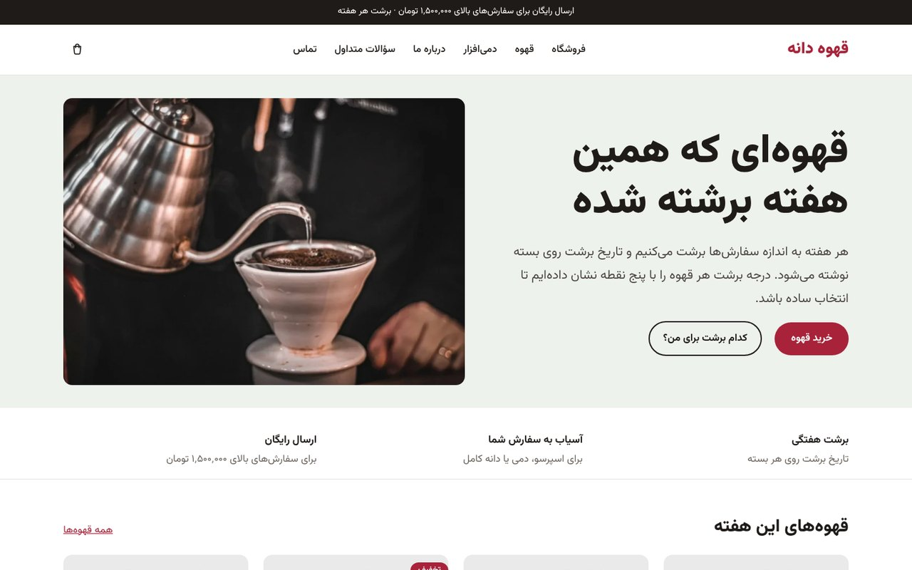
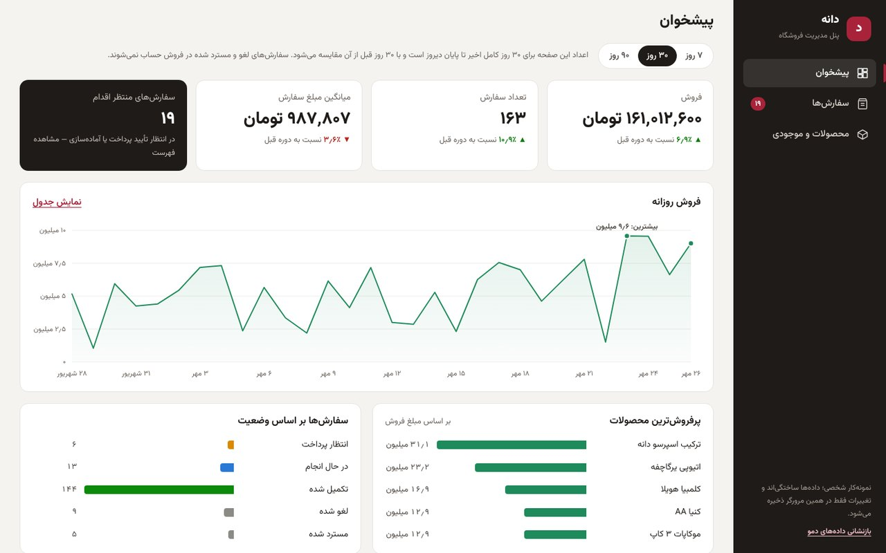
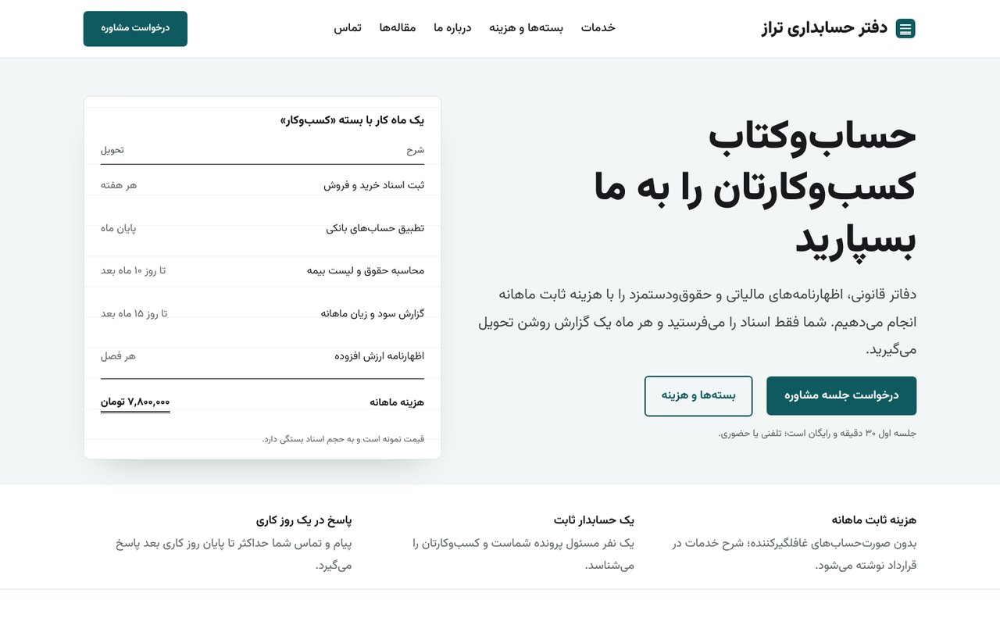
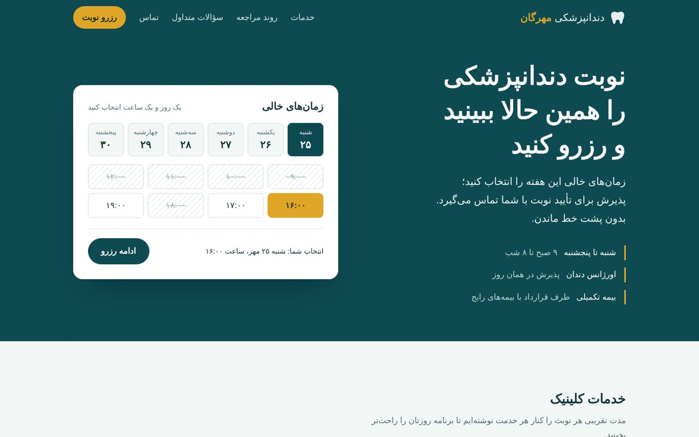
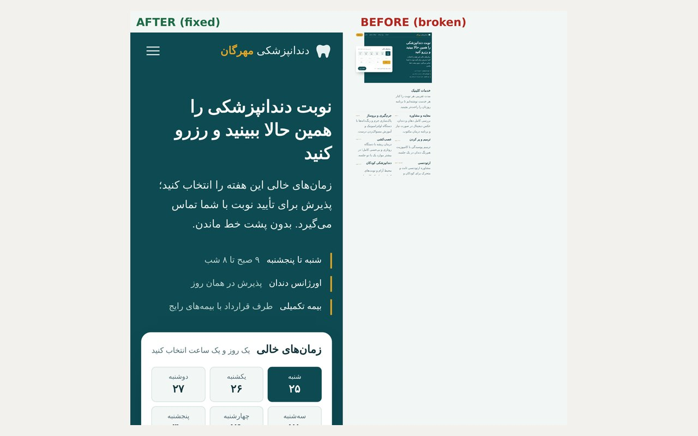

# سلام 👋

توسعه‌دهنده وب هستم: **طراحی سایت با وردپرس و ووکامرس، فرانت‌اند (HTML، CSS، JavaScript، React)** و رفع باگ سایت. پیش از این با **Oracle Database، PL/SQL و Oracle APEX** و راه‌اندازی سرور لینوکس (Nginx، ORDS) کار کرده‌ام.

سایت‌هایی می‌سازم که فارسی و راست‌به‌چپ درست کار کنند، در موبایل مرتب باشند، و صاحب کسب‌وکار بتواند خودش مدیریتشان کند. همه نمونه‌کارهای زیر با تست خودکار بررسی شده‌اند.

## نمونه‌کارها

همه موارد زیر نمونه‌کار شخصی‌اند؛ برندها و داده‌ها ساختگی‌اند و کد کامل هر کدام در مخزن خودش است.

<table>
<tr>
<td width="50%" valign="top">

 <b><a href="https://github.com/mtzdeveloper/dane-coffee-woocommerce">فروشگاه اینترنتی قهوه با ووکامرس</a></b>
 پوسته اختصاصی، تسویه حساب ایرانی، ارسال بر اساس استان، هویت برند و برچسب بسته‌ها، ۲۹ تست خودکار
</td>
<td width="50%" valign="top">

 <b><a href="https://github.com/mtzdeveloper/dane-admin-react">پنل مدیریت فروشگاه با React</a></b> · <a href="https://mtzdeveloper.github.io/dane-admin-react/">دموی آنلاین</a>
 نمودار فروش، مدیریت سفارش و موجودی، تاریخ شمسی، ریسپانسیو، ۳۸ تست
</td>
</tr>
<tr>
<td width="50%" valign="top">

 <b><a href="https://github.com/mtzdeveloper/taraz-wordpress-site">سایت شرکتی وردپرس برای دفتر حسابداری</a></b>
 پوسته بلوکی اختصاصی، فرم مشاوره با ضد اسپم، مدیریت درخواست‌ها در پیشخوان
</td>
<td width="50%" valign="top">

 <b><a href="https://github.com/mtzdeveloper/landing-clinic">لندینگ‌پیج کلینیک با رزرو نوبت</a></b> · <a href="https://mtzdeveloper.github.io/landing-clinic/">دموی آنلاین</a>
 HTML، CSS و JavaScript خالص، دسترس‌پذیر و سریع
</td>
</tr>
<tr>
<td width="50%" valign="top">

 <b><a href="https://github.com/mtzdeveloper/bug-fix-lab">Bug Fix Lab: رفع ۵ باگ رایج</a></b> · <a href="https://mtzdeveloper.github.io/bug-fix-lab/">قبل و بعد</a>
 علت‌یابی، رفع و اثبات هر باگ با تست Playwright
</td>
<td width="50%" valign="top">
</td>
</tr>
</table>

## ابزارها

`WordPress` `WooCommerce` `PHP` `HTML` `CSS` `JavaScript` `React` `Playwright` `Git` `Oracle APEX` `PL/SQL` `Linux` `Nginx`

## روش کار

- قبل از شروع، دامنه کار و معیار تحویل را مکتوب می‌کنم.
- روی نسخه آزمایشی کار می‌کنم، نه سایت در حال اجرا.
- همراه تحویل: راهنمای استفاده، فهرست تغییرات و روش بازگشت.

---

Web developer — WordPress & WooCommerce, front-end (React), and site bug fixing, with a background in Oracle APEX and PL/SQL. All projects above are personal portfolio pieces with fictional brands and data.
